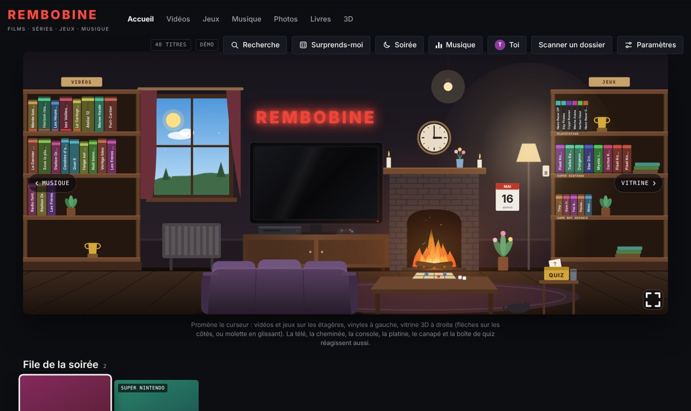
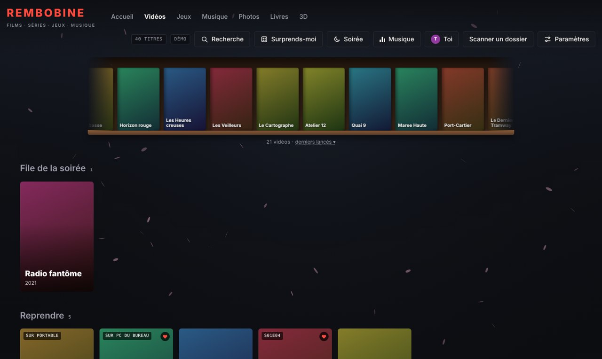
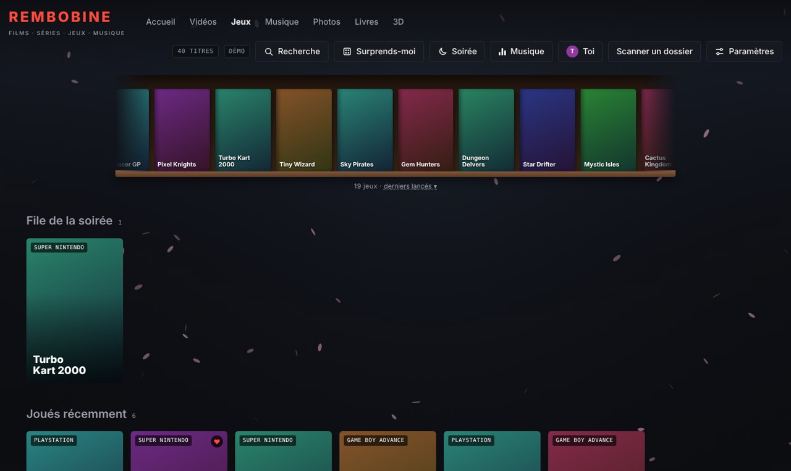
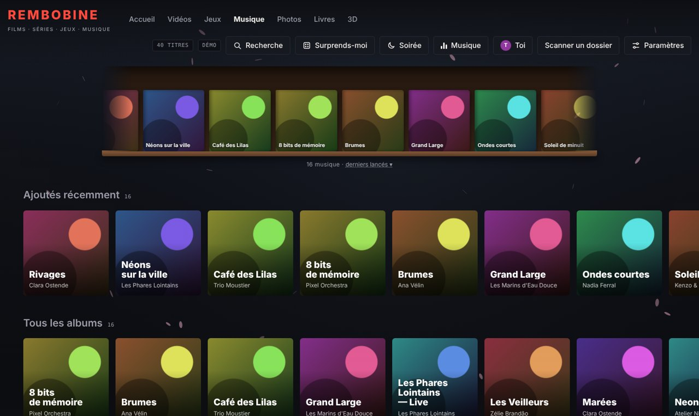
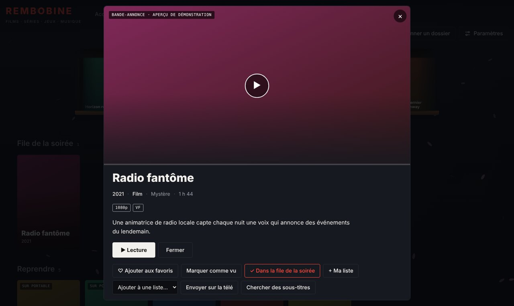
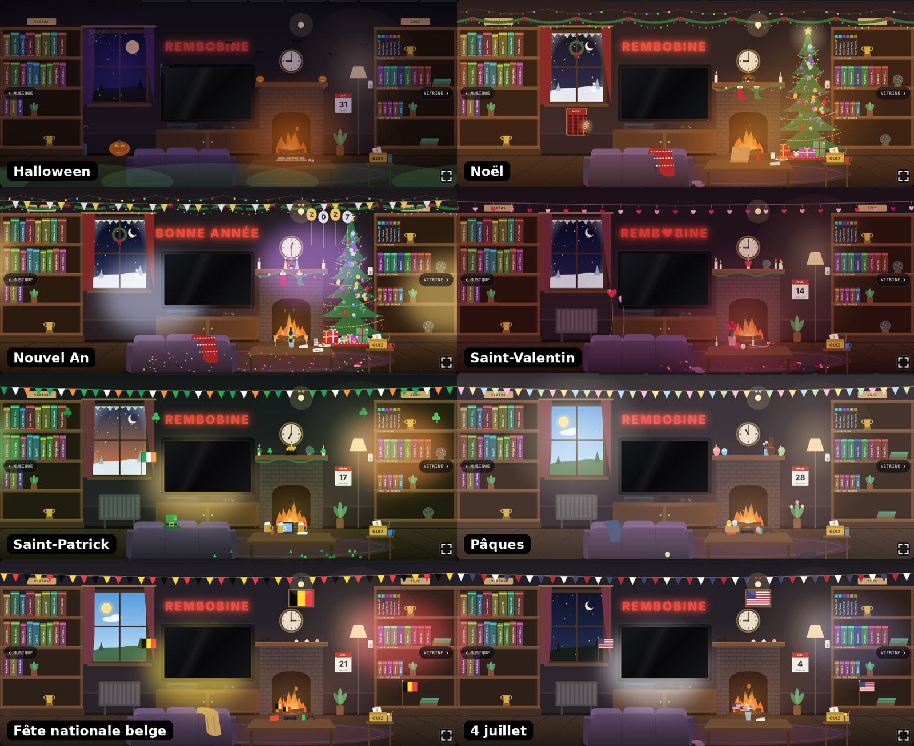
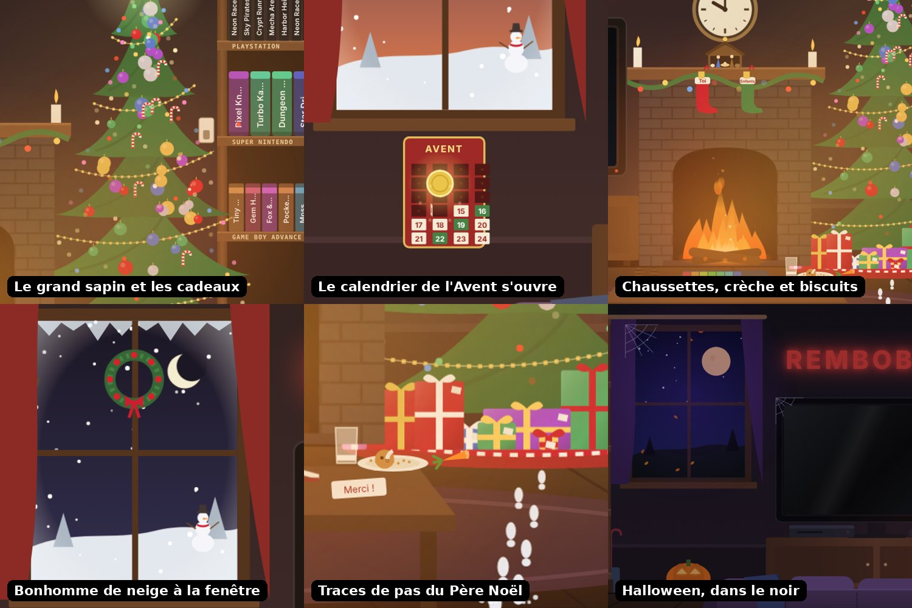
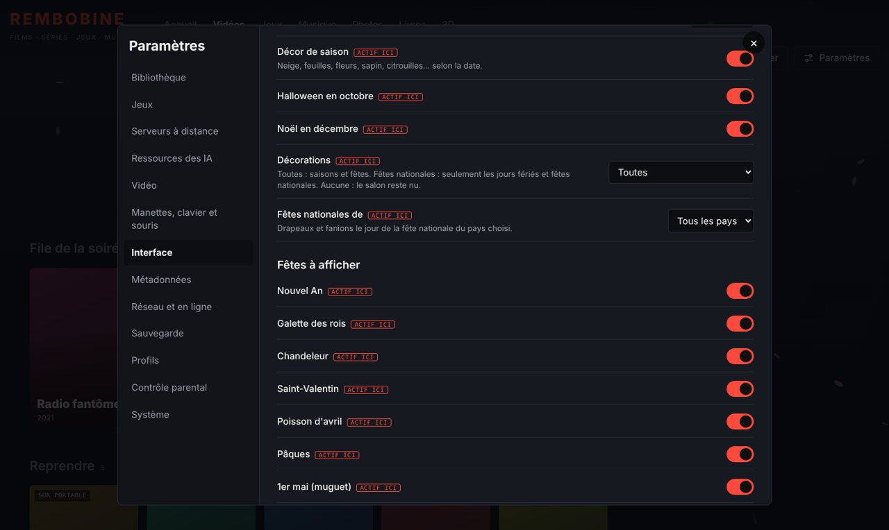

  

<h1 align="center">Rembobine</h1>

  <b>Films · Séries · Jeux · Musique</b> 
  Ta médiathèque, rangée dans un salon que tu peux explorer.

  Raspberry Pi · Linux · Android · Windows

  

---

## Le salon

L'accueil de Rembobine est un **salon dessiné**, où chaque meuble est un rayon de ta médiathèque : tes films et séries rangés dans la bibliothèque de gauche, tes jeux dans celle de droite, tes vinyles près du tourne-disque, ta prochaine soirée sur la télé du milieu.

On promène le curseur — ou le doigt, ou la manette — et on touche un objet pour l'ouvrir. La cheminée s'allume, la lampe se règle, le chat fait sa sieste sur le canapé, et la boîte de quiz attend sur sa table.

## Tous tes médias, au même endroit

<table>
<tr>
<td width="50%"></td>
<td width="50%"></td>
</tr>
<tr>
<td><b>Vidéos</b> — films et séries alignés sur l'étagère, ta file de la soirée, et « Reprendre » pour retrouver ce que tu avais commencé, au bon endroit, sur n'importe quel appareil.</td>
<td><b>Jeux</b> — tes jeux rétro rangés par console, avec leurs sauvegardes, leurs codes et la liste des derniers lancés.</td>
</tr>
<tr>
<td></td>
<td></td>
</tr>
<tr>
<td><b>Musique</b> — tes albums en pochettes, « Ajoutés récemment » et toute ta discothèque. Le tourne-disque du salon les joue pendant que tu navigues.</td>
<td><b>Une fiche pour chaque titre</b> — bande-annonce, résumé, qualité et langue, saisons et épisodes, favoris, listes, et « Envoyer sur la télé ».</td>
</tr>
</table>

Et aussi : **Photos** et **Livres**, une **recherche** qui trouve tout, **Surprends-moi** quand tu ne sais pas quoi regarder, le mode **Soirée**, et un **profil par personne** de la maison, avec ses favoris et son historique.

## Un salon qui vit au fil de l'année

Le salon suit la date du jour. Halloween, Noël, le Nouvel An, la galette, la Chandeleur, la Saint-Valentin, la Saint-Patrick, Pâques, le 1er mai, la fête de la musique, le 14 juillet, la Toussaint, la Saint-Nicolas… les fêtes du monde (Nouvel An lunaire, Hanami, Tanabata, Songkran, Oktoberfest, Thanksgiving, Día de Muertos, carnaval de Rio…), les fêtes religieuses (Aïd, Hanoukka, Diwali, Holi — un groupe qu'on peut désactiver d'un coup) et les **fêtes nationales de 31 pays**, drapeaux et fanions compris. Quand deux fêtes tombent le même jour, une seule décore le salon.

Clique sur le calendrier mural : une petite fiche raconte la fête du jour — quoi, quand, pourquoi, comment on la fête — vérifiée sur des sources sérieuses (voir [docs/sources-fiches-fetes.md](docs/sources-fiches-fetes.md)).

La lumière reste naturelle : seules les vraies sources (le sapin, les bougies, les lampions, la cheminée) apportent l'ambiance de la fête.

  

Les petits détails comptent : à Noël, un grand sapin couvert de boules et de guirlandes qui clignotent, des cadeaux qui s'ajoutent chaque jour, un calendrier de l'Avent dont la case du jour s'ouvre pour laisser sortir le chocolat, des chaussettes au prénom de chaque profil, les biscuits et le verre de lait du 24 au soir… et le 25 au matin, des traces de pas dans la neige jusqu'au sapin. Et selon la saison, de petites surprises apparaissent dans le salon.

  

## Réglé comme tu veux

  

Dans **Paramètres › Interface** : toutes les décorations, **seulement les fêtes nationales** (avec le pays de ton choix), ou **aucune**. Et chaque fête se coche ou se décoche une par une.

Et si tu regardes bien autour de toi… le salon cache peut-être d'autres surprises.

## Installer

| Appareil | Fichier |
|---|---|
| **Rembobine OS** — Raspberry Pi 4 / 5, carte SD prête à flasher | `Rembobine-OS-RaspberryPi.img.xz` |
| Raspberry Pi 4 / 5 qui a déjà Raspberry Pi OS | `Rembobine-RaspberryPi.tar.gz` |
| PC Linux | `Rembobine-Linux-PC.tar.gz` |
| Android | `Rembobine.apk` |
| Windows 10 / 11 | `Rembobine-Windows.zip` |

Les fichiers sont dans **[Releases](../../releases/latest)**. Le pas à pas pour chaque appareil est dans **[LISEZ-MOI.md](LISEZ-MOI.md)**.

**Rembobine OS** transforme un Raspberry Pi en box télé : on flashe la carte SD avec Raspberry Pi Imager, on branche le Pi sur la télé, et il démarre directement sur Rembobine, en plein écran — pas de bureau, pas de réglage.

## Ce que Rembobine ne fait pas

Rembobine ne fournit **aucun film, aucune série, aucun jeu, aucun BIOS**. Il lit uniquement les fichiers que tu possèdes et ranges sur ton appareil.

---

<b>Pour le développeur</b>

| Dossier | Contenu |
|---|---|
| `web/` | le logiciel (une seule page HTML) |
| `app/` | l'application de bureau (Linux, Raspberry Pi, Windows) |
| `android/` | l'écran de démarrage Android |
| `ci/` | les scripts de fabrication |
| `docs/` | les images de cette page |
| `.github/workflows/build.yml` | fabrique les quatre versions à chaque envoi |

Publier une version : chaque envoi sur `main` publie la version écrite dans le fichier `VERSION` (dans Releases). Nouvelle version = changer `VERSION`.
La clé de signature Android vit uniquement dans le secret `RBB_SIGNING_KEY`.

